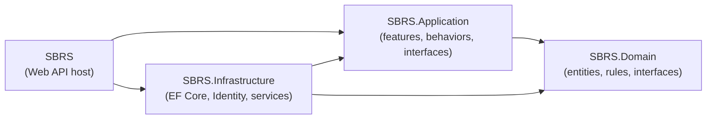
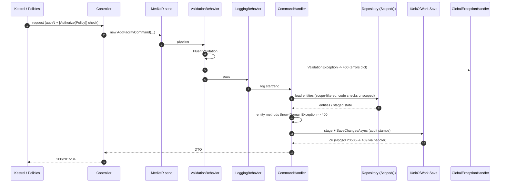

# SBRS Architecture
> Status: Draft | Last updated: 2026-11-07 | Owner: SBRS backend

Solution `SBRS.slnx`, target `net10.0`. Clean architecture with MediatR, FluentValidation, EF Core 10 (Npgsql), ASP.NET Identity `[BUILT]`.

## 1. Project layout and dependency rules (ADR-001)

| Project | Responsibilities | depends on |
|---|---|---|
| `SBRS.Domain` | entities (`*Entity`, private setters + methods), domain algorithms (`ArabicTextNormalizer`, `BeneficiaryMatchScorer`, code builders, `IdentityValuePatterns`), constants (`Roles`, `IdentityTypeCodes`, `AppClaims`), exceptions, repository interfaces, `IUnitOfWork` | nothing |
| `SBRS.Application` | features (command/validator/handler per file, manual `ToDto` mapping), behaviors (validation, logging), application interfaces (`ICurrentUser`, `ITokenService`, `IRefreshTokenService`, `IIdentityService`), `PagedResult<T>`, DTOs | Domain |
| `SBRS.Infrastructure` | `AppDbContext` + configurations + migrations + repositories (with `Scoped()` filters), ASP.NET Identity (`ApplicationUser`, `IdentityService`, `UserAdminService`), `TokenService`, `RefreshTokenService`, seeder | Application (child: DI wiring) |
| `SBRS` | controllers, request contracts, `Policies`, `GlobalExceptionHandler`, `CurrentUser`, `RefreshCookieService`, Swagger, CORS, seeds at startup | Application, Infrastructure |

Each layer exposes a `DependencyInjection` class: `AddApplication`, `AddInfrastructure(configuration)`, `AddAppDI(builder.Configuration)` — called from `Program.cs`.

## 2. Request pipeline

Key behaviors `[BUILT]`:

- **ValidationBehavior** runs every registered `IValidator<TRequest>`; failure → `ValidationException` → 400 with `errors` dictionary.
- **LoggingBehavior** logs handler name + duration (never body contents).
- Handlers load/stage via repositories; **only handlers call `IUnitOfWork.SaveChangesAsync`**.
- `AppDbContext.SaveChangesAsync` stamps `createdAt/updatedAt/createdBy/updatedBy` from the current user.
- **Scoping** comes from `ICurrentUser` (claims: sub, role, organization_id, facility_id; branch_id planned): repositories build a private `Scoped()` query. Code-uniqueness probes are deliberately unscoped (codes unique system-wide).
- Exception → HTTP mapping in `GlobalExceptionHandler` (RFC 7807): validation/domain 400, not-found 404, conflict 409 (incl. Npgsql `23505` → generic retry message), unauthorized 401, everything else 500 without detail.

## 3. Conventions when adding a feature

1. Domain: entity `XEntity : BaseEntity` with private setters, a parameterized constructor, `Update`/`Deactivate` methods throwing `DomainException`, plus `IXRepository` in `Domain/Interfaces` if persistence is needed.
2. Infrastructure: `XConfiguration : IEntityTypeConfiguration<XEntity>` (snake_case columns, indexes, FKs), repository implementing the interface with a `Scoped()` filter, register in `AppDbContext` (`DbSet` + config).
3. Application: `Features/X/{Commands|Queries}/DoXCommand.cs` holding command record + validator + handler; `Features/X/DTOs` + `Features/X/Mappings` manual `ToDto`; register nothing (MediatR scans).
4. API: request record(s) in `Contracts/X`, thin controller method combining route/body/current-user into the command, `ActionResult<T>` for data, `IActionResult` + 204 for mutations without body, explicit `[Authorize(Policy = ...)]`; add the policy in `Policies.cs` if new.
5. Migration: `dotnet ef migrations add X -p SBRS.Infrastructure -s SBRS.API -o Persistence/Migrations` (see operations docs).
6. Docs in the same commit (docs/README rule 1).
7. New durable decisions → ADR under `02-design/decisions/`.

## 4. Known structural gotchas (from the owner's history)

- `AppDbContext` must stay `IdentityDbContext`-derived (the Identity migration broke otherwise).
- Two `RefreshToken` classes once shadowed each other (Infrastructure.Identity vs Application-model); exactly one exists now.
- `ApplicationUser` lives in **Infrastructure**, not Domain.
- `Application.Common.Settings.JwtSettings` duplicates `Infrastructure.Identity.JwtSettings` (OQ-24) — the Infrastructure one is bound.
- Migration history had SQL Server leftovers; the PostgreSQL reset re-seeded fresh (ADR-013).

## 5. Startup sequence

1. `Program.cs` builds the host: controllers, OpenAPI + SwaggerGen (Bearer scheme, `X-Client-Type` header operation filter), CORS (origins from config), `AddAppDI` (JWT bearer with issuer/audience/`jwt.Key`, **`ClockSkew = Zero`** — access-token lifetime enforced exactly).
2. `IdentitySeeder.SeedAsync()` runs in a scope before serving: creates the six roles + the first SystemAdmin (this is why the Swagger CLI export needs a live DB).
3. Middleware pipeline: `UseForwardedHeaders` (X-Forwarded-For/Proto for the reverse proxy), `UseExceptionHandler` (RFC 7807), `UseHttpsRedirection`, `UseCors` (default policy), authentication, authorization, controllers.
4. Swagger UI + `/swagger/v1/swagger.json` is enabled **explicitly in Development and Production** (`RoutePrefix = ""` — the UI is the site root; OQ-25).

## 6. Related

- Decisions: [decisions/README.md](decisions/README.md)
- ERD: [erd.md](erd.md); tables: [data-dictionary.md](data-dictionary.md)
- Conventions source: root `ARCHITECTURE.md` (kept in sync with this file)
