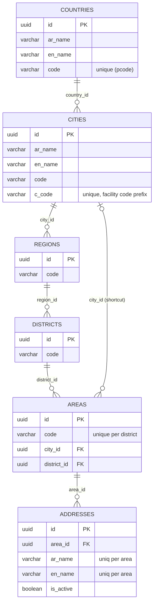
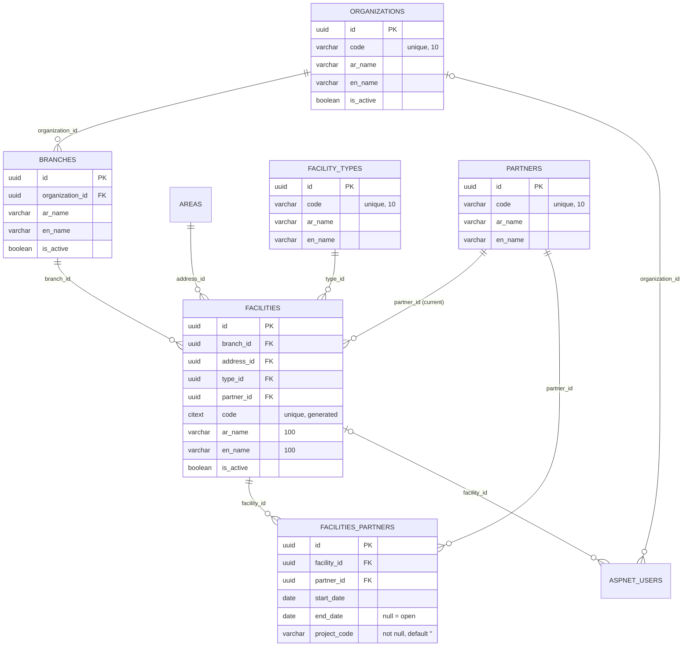
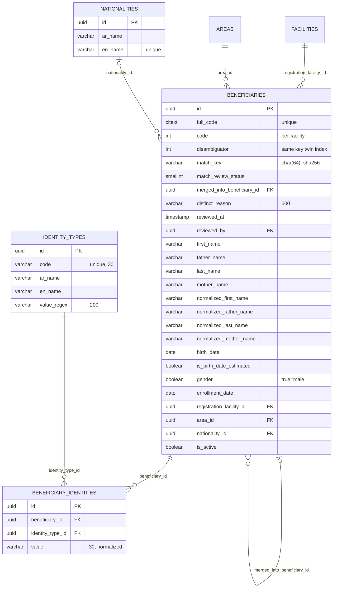
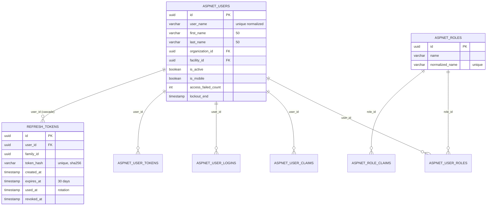

# SBRS Entity-Relationship Diagram
> Status: Draft | Last updated: 2026-11-07 | Owner: SBRS backend

Generated from the EF model snapshot (`AppDbContextModelSnapshot.cs`), not from memory. A human-drawn version will live as `erd.png` next to this file (added by the owner):

## 1. Mermaid ERD — geography and addresses

## 2. Organization structure and partners

## 3. Beneficiaries

## 4. Identity, users, tokens

## 5. Simple lookup tables

`accommodation_types`, `disability_types`, `education_types` — `id`, `ar_name(100)`, `en_name(100) unique`, audit columns. Currently referenced by nothing (OQ-32).

## 6. Cardinality notes

- All geometry/organization FKs are **required** (non-null `Guid` + domain checks); optional ones are `beneficiaries.merged_into_beneficiary_id`, `beneficiaries.reviewed_by`, `aspnet_users.organization_id/facility_id`, `areas.city_id`? — **no**: `areas.city_id` and `district_id` are required by the entity; the parser showed them nullable only because nullability came from configuration. Entity types say non-null `[BUILT]`.
- All domain FKs are **Restrict** (no cascade); the Identity-owned tables (`AspNetUserRoles`, `AspNetUserClaims`, `AspNetUserLogins`, `AspNetUserTokens`, `AspNetRoleClaims`) and `refresh_tokens.user_id` are **Cascade** `[BUILT]` (BR-GEN-06; `branches.organization_id` = NoAction, OQ-35).
- `beneficiaries.merged_into_beneficiary_id` is the merge link; the merged row keeps its own row (full history) and is hidden by `match_review_status = 3`.
- `facilities.partner_id` is required at creation (domain check "Partner is required."); `facilities_partners.end_date` NULL marks the open assignment.
