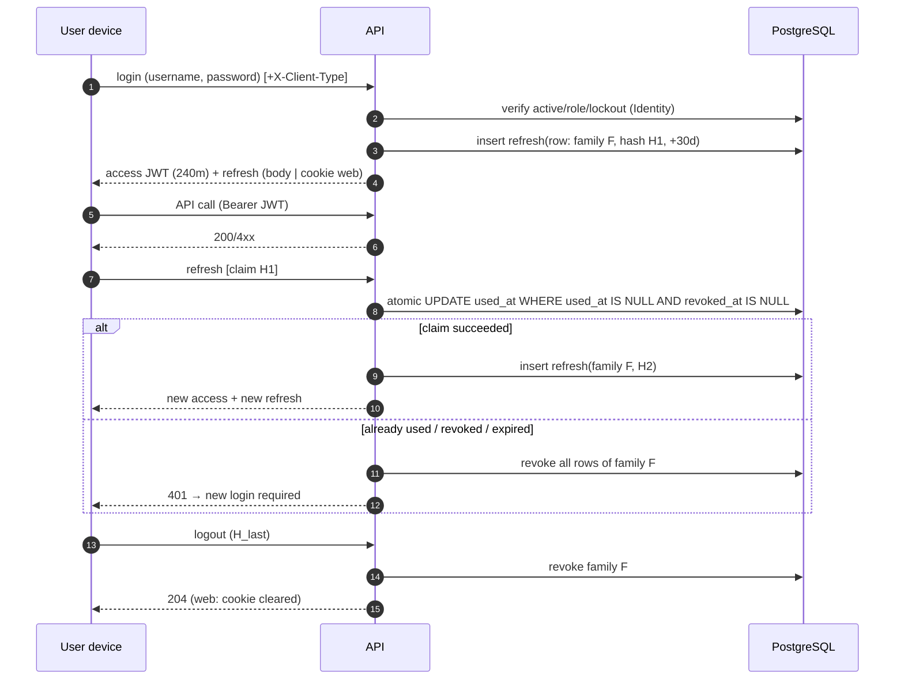

# Workflow — Authentication and Tokens
> Status: Draft | Last updated: 2026-11-07 | Owner: SBRS backend

Design-level companion to [../../03-integration/auth-guide.md](../../03-integration/auth-guide.md) (client-facing). All `[BUILT]` unless tagged; decision basis ADR-005 + ADR-014.

## Design summary

| Aspect | Decision |
|---|---|
| Access token | JWT (HS256, `Jwt:Key`), issuer/audience validated, **240 minutes** `[CONFIRMED]`; `ClockSkew = Zero` — expired tokens rejected immediately |
| Claims | `sub` (user id), `unique_name`, `role`, `jti`, `organization_id`, `facility_id`, `is_mobile`; `branch_id` `[PLANNED]` |
| Refresh token | 30 days, SHA-256 hashed at rest (`refresh_tokens.token_hash`, unique), single-use |
| Rotation | every refresh burns the old token (`used_at`) and issues a new sibling in the same `family_id` |
| Reuse detection | refreshToken of a used/burned token revokes the **whole family** (`revoked_at` on all rows) |
| Refresh hard-checks | user reloaded from DB: must exist, `IsActive`, not locked, role present — otherwise 401 + family revoked |
| Web delivery | HttpOnly cookie `sbrs_rt` (`/api/auth` path, `Secure`, `SameSite=Lax` configurable) when `X-Client-Type: web` |
| Mobile delivery | JSON body field `refreshToken` |
| Logout | `logout` revokes one token's family (body or cookie); web deletes the cookie. `logout-all` revokes **all** families of the user (any device) |
| Session depth | `logout-all` requires authentication (it's authorized); login/refresh/logout anonymous by design (the token itself is the credential) |

## Token lifetime vs revocation gap `[CONFIRMED]`

- Deactivation/role change revokes refresh tokens immediately `[BUILT]`, but an **access token stays valid until its own expiry** (≤ 4 h) because no request-time session check exists.
- Known outcomes: recently deactivated user can call write endpoints ≤ 4 h; harmless in practice? for sensitive ops the owner may shorten the lifetime or add a per-request check — open (OQ-05).

## Why this design (ADR-005 refresher)

1. Stateless JWT keeps request handling cheap; no DB lookups per request.
2. Rotating single-use refresh tokens make stolen-token reuse detectable (family kill).
3. Hashed storage means a DB dump cannot mint sessions.
4. HttpOnly cookie protects XSS-prone web clients; the custom `X-Client-Type` header doubles as CSRF hardening for cookie flows (simple cross-site posts cannot send it) `[BUILT]`.

## Sequence (design view)

## Cleanup duty `[PLANNED]`

Burned/revoked/expired rows accumulate forever (`RefreshTokens`); `expires_at` nullable was designed for "session tokens" but is unused today. A periodic cleanup (e.g. delete `revoked_at`/`used_at` older than 30 days) is planned — retention decision OQ-31.

## For implementers of new endpoints

- Never read the user's identity from the request body; always from `ICurrentUser` (claims) `[BUILT]`.
- Scope changes must trigger `IRefreshTokenService.RevokeAllForUserAsync` so claim-bearing tokens do not outlive their rights `[BUILT]`.
- Any "anonymous endpoint" decision must be deliberate (`[AllowAnonymous]`) — the fallback policy protects everything else.
