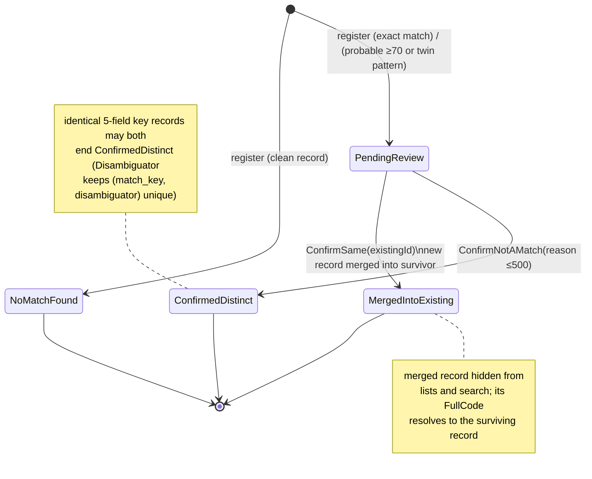

# Workflow — Beneficiary Match Review
> Status: Draft | Last updated: 2026-11-07 | Owner: SBRS backend

How `BeneficiaryMatchReviewStatus` records move between states (UC-09), `[BUILT]` unless tagged.

## State diagram

## Status values (transfer as numbers)

| Value | Name | Meaning |
|---|---|---|
| 0 | `NoMatchFound` | normal registration |
| 1 | `PendingReview` | awaits the facility admin decision |
| 2 | `ConfirmedDistinct` | explicitly a different person (+ optional `distinct_reason` ≤ 500, `reviewed_at/by` stamped) |
| 3 | `MergedIntoExisting` | merged into the selected survivor via `merged_into_beneficiary_id`; hidden everywhere |

## FacilityAdmin decision flow (numbered)

1. `GET api/Beneficiaries/PendingReview` → this facility's undecided records, oldest first (SA: all facilities) `[BUILT]`.
2. `GET api/Beneficiaries/{id}/MatchCandidates` → up to N candidates each with `score`, `status` (Probable/Exact) and bitmask `reasons`; includes full demographics and identity of the candidates `[BUILT]`.
3. Decide:
   - **Same person** → `POST {id}/ConfirmSame { existingBeneficiaryId }`; the id must be one of the presented candidates and not the record itself; the record becomes MergedIntoExisting `[BUILT]`.
   - **Different person** → `POST {id}/ConfirmNotAMatch { reason? }`; Optional reason visible for audit; review stamps set; record stays active and listable `[BUILT]`.
4. Each refused/delayed record remains in PendingReview → visible with age (aging queue) `[BUILT]`.

## Guard rails

| Situation | Behaviour |
|---|---|
| No pending review on that record | `400` "This beneficiary has no pending match review." |
| `existingBeneficiaryId == record id` | `400` "Invalid beneficiary selected." |
| Id not among candidates | `400` "The selected beneficiary is not one of the match candidates." |
| Other facility's record (non-SA) | `404` (scoping) |
| DataEntry attempts review | `403` (policy `ReviewBeneficiaryMatches` = FA + SA) |

## Open questions tied to this workflow

- What exactly migrates to the survivor when merging (identities? enrollment info?) — the code links the row but data migration semantics are worth verifying during testing (part of UC-09 postconditions test).
- FacilityBeneficiary enrollment `[PLANNED]` will add a "confirmed same, enroll in facility B" outcome (BR-BEN-12 / Section 4 intent).
