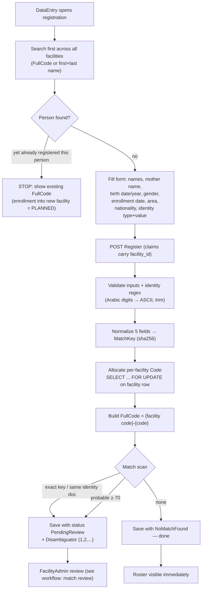

# Workflow — Beneficiary Registration
> Status: Draft | Last updated: 2026-11-07 | Owner: SBRS backend

Design-level flow of `POST api/Beneficiaries/Register` (UC-08), driven by BR-BEN-01…12 + the code `[BUILT]` unless tagged.

## Flowchart

## Numbered steps

1. **Search-first gate** — the client should not enable registration before a search (UC-07) returns "not found". `[CONFIRMED]` UI rule; not enforced server-side.
2. Client sends the register request with facility implied by the user's `facility_id` claim (policy `RegisterBeneficiaries` = DataEntry only, OQ-12).
3. Server validates: names non-empty after normalization (≤ 100 each), birth date ≥ 1900 and not in future, enrollment date not in future (OQ-18: default `0001-01-01` slips through), gender bool, area/nationality/identity-type exist (also checked as active).
4. Identity: value trimmed, Arabic/Persian digits → ASCII (`IdentityValueNormalizer`), regex per type enforced; `UNREGISTERED` must be empty `[BUILT]`.
5. Normalized names + birth date → `match_key`; the record is built by `BeneficiaryEntity` (Constructor-checks → `DomainException` → 400).
6. `Code` allocation: repository takes a row lock (`SELECT 1 FROM facilities WHERE id = … FOR UPDATE`), reads max code of that facility, takes the next — concurrent registrations cannot collide; `[CONFIRMED]` counters per facility, no global sequence.
7. `full_code = {facility code}-{code}` (no padding), unique index as final guard.
8. Match evaluation (next section). Status `PendingReview` or `NoMatchFound`; response `{ id, code, fullCode, matchReviewStatus }`.
9. On a DB unique violation at any step → HTTP 409 with the generic retry message.

## Match statuses at registration

| Outcome | Condition | Result |
|---|---|---|
| Exact | same 5-field key (key used already → Disambiguator++) **or** same identity type+non-empty value (reason `SameIdentity`, score 100) | saved PendingReview |
| Probable | weighted score ≥ 70 (names/DOB; half weight for estimated-year equality; twin pattern always shown to human) | saved PendingReview |
| None | nothing scored high | saved NoMatchFound |

Inactive beneficiaries **are** included in candidate scanning on purpose (a deactivated person must not be silently re-registered) `[BUILT]`.

## What the FacilityAdmin can do afterwards
See [beneficiary-match-review.md](beneficiary-match-review.md).

## Known gaps / open items

- Facility-level enrollment of an existing person is `[PLANNED]` (`FacilityBeneficiary`) — today a search hit means "stop", the person cannot be attached to a second facility.
- Search is not audited/rate-limited `[PLANNED]`.
- Birth-year-only → January 1st conversion is the **client's** duty (BR-BEN-05); the server stores what it receives plus the estimated flag.
