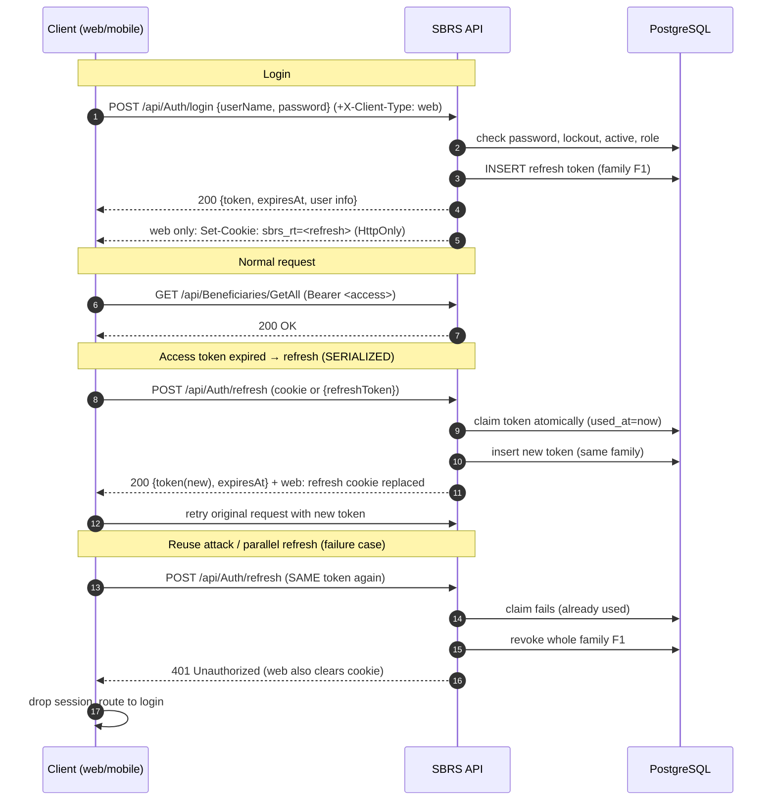

# SBRS Authentication Guide
> Status: Draft | Last updated: 2026-11-06 | Owner: SBRS backend

For the web and mobile clients. Everything below is `[BUILT]` (verified in `AuthController`, `TokenService`, `RefreshTokenService`, `RefreshCookieService`) unless tagged.

## 1. Endpoints

| Method | Route | Auth | Body | Result |
|---|---|---|---|---|
| POST | `api/Auth/login` | anonymous | `LoginRequest` | `LoginResultDto` (201/200) |
| POST | `api/Auth/refresh` | anonymous | `RefreshTokenRequest` (web: ignored; token from cookie) | `LoginResultDto` |
| POST | `api/Auth/logout` | anonymous | `RefreshTokenRequest` (web: ignored; token from cookie) | `204` |
| POST | `api/Auth/logout-all` | any logged-in user | — | `204` (revokes every refresh token of the caller, incl. phones) |
| GET | `api/Auth/me` | any logged-in user | — | `{ userId, role, organizationId, facilityId, isSystemAdmin }` |

## 2. Login

Request:

```json
{ "userName": "demo.user", "password": "<EXAMPLE_PASSWORD>" }
```

Response (`LoginResultDto`) — fake values:

```json
{
  "token": "<ACCESS_TOKEN_JWT>",
  "refreshToken": "<REFRESH_TOKEN_OR_NULL>",
  "expiresAt": "2026-11-06T12:40:00Z",
  "userId": "3f0d1c9a-5b2e-4111-8a20-6c7d8e9f0a1b",
  "userName": "demo.user",
  "firstName": "Ahmad",
  "lastName": "Arbash",
  "role": "FacilityAdmin",
  "organizationId": "0c1d2e3f-4a5b-4c22-8d90-1e2f3a4b5c6d",
  "facilityId": "9a8b7c6d-5e4f-4001-92a3-b4c5d6e7f809",
  "isMobile": false
}
```

- `token` is a JWT with claims: `NameIdentifier` (user id), `Name` (username), `Role`, `jti`, plus `organization_id` / `facility_id` when set. Branch claim is `[PLANNED]`.
- `ExpiresAt` is the **access token** expiry (240 minutes `[CONFIRMED][BUILT]`); `DateTime` UTC.
- Login fails with `401 { "title": "Unauthorized", "detail": "Unauthorized" }` — same body for wrong password, inactive user, locked-out user, or user without a role.

## 3. Web vs mobile: where the refresh token goes

Send header `X-Client-Type: web` on the auth endpoints (`login`, `refresh`, `logout`) to switch the web flow. Any missing/other value behaves as mobile `[BUILT]`.

| Client | Access token | Refresh token delivery |
|---|---|---|
| **Web** | keep **in memory only** (never in localStorage/sessionStorage) | **HttpOnly cookie** `sbrs_rt`, `Path=/api/auth`, `Secure`, `SameSite=Lax` default; configured via `RefreshCookie:{Name,Path,SameSite,Secure,Domain}` section |
| **Mobile (any client** without the header**) | in memory or secure storage per your stack | in the JSON body (`refreshToken` field) |

- On the web the response body's `refreshToken` is **null** (`result with { RefreshToken = null }` in `AuthController`); the cookie carries the token.
- The X-Client-Type header forces a CORS preflight, which doubles as CSRF protection for the cookie flow (custom headers cannot be attached to plain cross-site form posts) `[BUILT]`.
- CORS requires explicit configured origins + `AllowCredentials`.

## 4. Refresh flow

`POST api/Auth/refresh` returns the same `LoginResultDto` shape with a **new access token and a new refresh token** (rotation). Rules `[BUILT]`:

- Every refresh **burns** the used refresh token (`UsedAt`) and issues a token in the same *family* (same `FamilyId`).
- **Single use is enforced atomically** in SQL (`ExecuteUpdate ... WHERE used_at IS NULL AND revoked_at IS NULL`).
- **Reusing a burned token revokes the whole family** (every device of that login) and returns 401.
- Refresh reloads the user: inactive, locked-out or role-less users are refused (401) and their token family is revoked.

**Serialize refresh calls.** Two tabs refreshing in parallel (or two 401 retries racing) means one of them uses an already-burned token → family revoked → forced logout everywhere. Recommended client pattern:

1. Keep **one** pending refresh promise per app instance.
2. On any 401: if a refresh is running, wait for it; otherwise start exactly one `refresh` call.
3. If refresh returns 401 → discard the session and route to login.
4. Retried request must carry the *new* access token from `expiresAt`-aware state.

## 5. Logout

- `logout` (anonymous, takes the token from body or web cookie): revokes the token **family** (all devices of that login). Web also deletes the cookie. Missing cookie on web is still `204`.
- `logout-all` (authorized): revokes every refresh token of the user, and also deletes the web cookie.

## 6. Expiry and 401 handling

| Situation | What the client must do |
|---|---|
| Access token expired (expired JWT) | silent `refresh` once, then retry the request with the new token |
| Refresh fails with 401 | route to login screen; discard state |
| 401 **after** deactivation/role change | same — token family was revoked server-side on role/scope change or deactivation `[BUILT]` |
| 403 Forbidden | do **not** retry; hide the action (role is not allowed on the endpoint) |

Known caveat `[CONFIRMED]`: an **access token stays valid until it expires (up to 4 h)** after logout, deactivation or role change — it is not re-checked per request. Options are being discussed (shorter token / session check) — see [OPEN-QUESTIONS.md](../OPEN-QUESTIONS.md#oq-05).

## 7. Sequence diagram



## 8. Token storage recommendations

| Platform | Access token | Refresh token |
|---|---|---|
| Web SPA | memory (closure/observable) | rely on the HttpOnly cookie; never read it from JS |
| Flutter/Dart | memory + easy re-login | `flutter_secure_storage` |
| Native Android/iOS | memory | Keystore / Keychain (secure storage) |

Never persist the access token in `localStorage`, `sessionStorage`, or crash-state on mobile. After app restart: silent refresh from the cookie/secure-refresh; if it fails, show login. A lost refresh response forces a new login `[CONFIRMED]`.

## 9. Swagger

Paste the JWT **without** the `Bearer ` prefix (the UI adds it).
